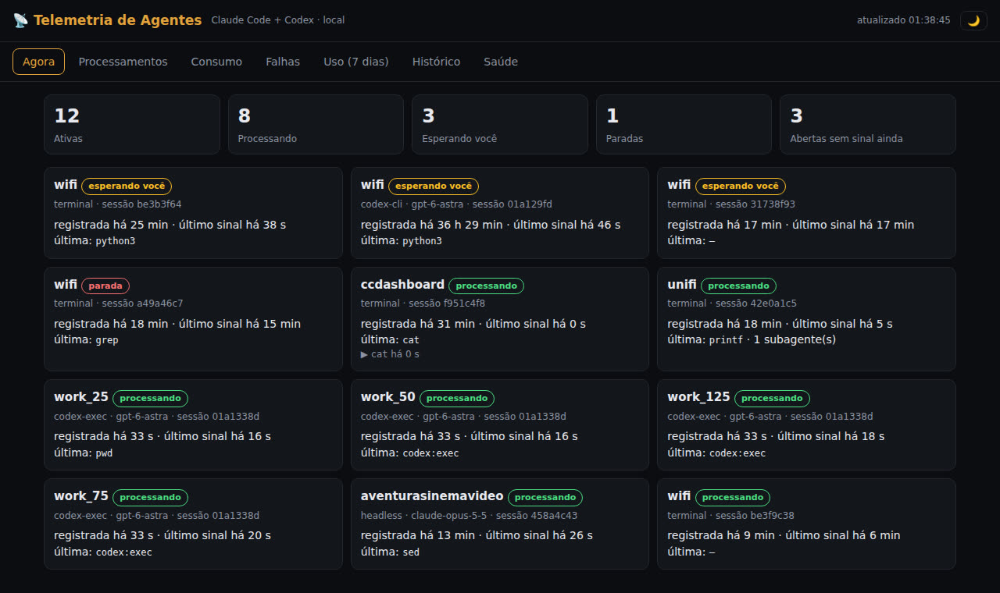

# ê°Å¸â€œÅ  CC Dashboard ê¢â‚¬â€ painêƒÂ©is ao vivo no Claude

<div align="center">
  
  <p><strong>Arckhé AI</strong></p>
</div>


[](https://linnoff88-dev.github.io/

**ê°Å¸â€¡Â§ê°Å¸â€¡Â· [PortuguêƒÂªs](README.md) ê‚· ê°Å¸â€¡Âºê°Å¸â€¡Â¸ [English](README.en.md) ê‚· ê°Å¸â€¡Âªê°Å¸â€¡Â¸ [EspaêƒÂ±ol](README.es.md)**

## O que êƒÂ©

O CC Dashboard êƒÂ© um kit em portuguêƒÂªs para usar os Dashboards do Claude, painêƒÂ©is que guardam as consultas e refazem as contas sempre que vocêƒÂª abre. Serve para donos de pequenos negêƒÂ³cios e para quem usa o Claude Code todo dia. Ele traz prompts prontos para montar painêƒÂ©is do negêƒÂ³cio (dinheiro, atrasos, vazamentos) e um plano para medir o prêƒÂ³prio Claude Code (custo estimado, ferramentas, falhas). Para usar, vocêƒÂª precisa de um plano pago do Claude e, nas partes com banco de dados, de uma conta gratuita no Supabase.

## ê°Å¸â€œâ€“ Guia de uso

Guia completo (landing + passo a passo): **https://linnoff88-dev.github.io/

## Como funciona

Um Dashboard do Claude nêƒÂ£o grava nêƒÂºmeros: grava **consultas**. Toda vez que vocêƒÂª abre ou atualiza, ele roda as consultas de novo nos dados conectados. Clicando num nêƒÂºmero, vocêƒÂª vêƒÂª a consulta e a hora da êƒÂºltima atualizaêƒÂ§êƒÂ£o.

**NegêƒÂ³cio**

```
Apps (CRM, planilha, banco) ê¢â€ â€™ Conector no Claude ê¢â€ â€™ [Base central no Supabase] ê¢â€ â€™ Dashboard ê¢â€ â€™ CêƒÂ³pia agendada
```

- Uma pergunta que cabe num app sêƒÂ³: conector + prompt e pronto.
- Uma pergunta que cruza apps (horas êƒâ€” faturas, assinaturas êƒâ€” cobranêƒÂ§as): os registros precisam ser copiados para uma base central (Supabase = Postgres hospedado), que guarda histêƒÂ³rico e permite cruzar.

**Claude Code**

```
Claude Code (OpenTelemetry) ê¢â€ â€™ Coletor no Supabase ê¢â€ â€™ Tabelas brutas (7 dias) ê¢â€ â€™ Resumo diêƒÂ¡rio (10 min) ê¢â€ â€™ Dashboard
```

- O Claude Code envia a prêƒÂ³pria telemetria (modelo, tokens, custo estimado, ferramentas, duraêƒÂ§êƒÂ£o, falhas).
- O coletor guarda **sêƒÂ³ campos de uma lista permitida** e descarta texto de prompts e respostas, comandos completos, caminhos, entradas e saêƒÂ­das de ferramentas, texto de erro e e-mail. Do shell, guarda sêƒÂ³ o nome do programa.
- Um resumo diêƒÂ¡rio êƒÂ© recalculado a cada 10 minutos; os brutos sêƒÂ£o apagados apêƒÂ³s 7 dias.

## Como usar

| Passo | O que fazer | Arquivo |
|---|---|---|
| 1 | Ligar o conector do app em *Customize ê¢â€ â€™ Connectors* | ê¢â‚¬â€ |
| 2 | Pedir o painel com pergunta, definiêƒÂ§êƒÂµes e "nêƒÂ£o altere dados" | `prompts/01-dashboard-negocio.md` |
| 3 | Conferir um nêƒÂºmero na origem antes de agir | `prompts/02-conferir-numero.md` |
| 4 | Cruzar apps numa base central no Supabase | `prompts/03-base-central.md` |
| 5 | Agendar a atualizaêƒÂ§êƒÂ£o da base | `prompts/05-agendar-atualizacao.md` |
| 6 | DiagnêƒÂ³stico do negêƒÂ³cio ê¢â€ â€™ plano ê¢â€ â€™ painel de acompanhamento | `prompts/06-diagnostico-negocio.md` |
| 7 | Montar o painel do Claude Code (banco, coletor, abas) | `prompts/04-observabilidade-claude-code.md` |
| 8 | Ligar a telemetria no `~/.claude/settings.json` e **reiniciar** o Claude Code | `config/claude-code-otel.example.json` |

Supabase sêƒÂ³ leitura e restrito a um projeto (conector personalizado):

```
https://mcp.supabase.com/mcp?project_ref=SEU_PROJECT_REF&read_only=true
```

Se nada chegar no coletor: `claude --debug-file /tmp/cc.log` e procure linhas `[3P telemetry]`. A tabela de sintomas (401, 404, 415, cartêƒÂµes vazios) estêƒÂ¡ no fim de `prompts/04-observabilidade-claude-code.md`.

## Telemetria de agentes (Frente C) ê¢â‚¬â€ local, sem nuvem

Painel na sua prêƒÂ³pria mêƒÂ¡quina com **todas** as sessêƒÂµes do Claude Code (terminais, bots, `claude -p`, subagentes) e do Codex, ao vivo: o que estêƒÂ¡ processando, o que espera vocêƒÂª, o que falhou, tokens e custo estimado. Sem API, sem conta nova.



```bash
./help.sh                          # ajuda completa
./help.sh ligar                    # hooks + OpenTelemetry no ~/.claude/settings.json (com backup), painel e manutenêƒÂ§êƒÂ£o
telemetria/telemetria.sh status    # o que estêƒÂ¡ ligado agora
./help.sh desligar                 # tira tudo do settings.json e para os serviêƒÂ§os (o banco fica)
systemctl --user stop telemetria-painel.service   # sêƒÂ³ pausar o painel
```

- **Painel:** `http://127.0.0.1:8766/` e, na rede local, `http://<ip-da-maquina>:8766/` (endereêƒÂ§os em `TELEMETRIA_HOSTS`, redes liberadas em `TELEMETRIA_REDES`). Abas: Agora, Processamentos, Consumo, Falhas, Uso, HistêƒÂ³rico, SaêƒÂºde.
- **O que êƒÂ© guardado:** sêƒÂ³ nomes (projeto, ferramenta, skill, programa) e nêƒÂºmeros. Nunca prompt, resposta, comando completo, caminho de arquivo nem saêƒÂ­da de ferramenta. Banco em `~/.local/share/telemetria-agentes/` (30 dias de eventos + resumo diêƒÂ¡rio).
- **Custo de mêƒÂ¡quina (medido):** ~60 ms a mais por chamada de ferramenta, ~13 MB de RAM, 3ê¢â‚¬â€œ5 MB de disco por dia (teto ~150 MB). Nada sai da mêƒÂ¡quina.
- **Limites:** tokens e custo sêƒÂ³ nas sessêƒÂµes do Claude Code abertas depois de ligar; custo êƒÂ© estimativa em preêƒÂ§o de API (o Codex nêƒÂ£o informa preêƒÂ§o); o painel nêƒÂ£o tem senha ê¢â‚¬â€ qualquer aparelho da rede liberada vêƒÂª. Testado no Linux.
- Detalhes, testes e fases: [`telemetria/PLANO.md`](telemetria/PLANO.md).

## PrêƒÂ©-requisitos

- Plano pago do Claude: Pro, Max, Team ou Enterprise (recurso em beta, conta no uso do plano).
- Conta Supabase grêƒÂ¡tis (500 MB; projeto grêƒÂ¡tis pausa apêƒÂ³s uma semana sem uso) ê¢â‚¬â€ para base central e Claude Code.
- Claude Code ê¢â‚¬â€ sêƒÂ³ para o painel de observabilidade.

## Limites

- **Mostra, nêƒÂ£o avisa.** Alerta exige uma rotina agendada separada.
- **Custo êƒÂ© estimativa** em preêƒÂ§o de API; em Pro/Max vale a assinatura.
- **Cada pessoa precisa da prêƒÂ³pria conexêƒÂ£o** ao projeto Supabase para ver os cartêƒÂµes.
- **Nomes ficam guardados** (skills, repositêƒÂ³rios, servidores MCP) ê¢â‚¬â€ pense em quem vêƒÂª.
- **SêƒÂ³ Claude Code**; o chat do app e o Cowork nêƒÂ£o entram.
- **Teste no seu sistema** (Linux, Windows, Mac) antes de confiar no fluxo.

## Estrutura

```
PLANO.md                               plano por fases (Frente A negêƒÂ³cio, Frente B Claude Code)
telemetria/PLANO.md                    Frente C: telemetria local de agentes (Claude Code + Codex); ligar/desligar: telemetria/telemetria.sh
help.sh                                ajuda + ligar/desligar a telemetria
prompts/01-dashboard-negocio.md        painel a partir de um app
prompts/02-conferir-numero.md          checklist para conferir um nêƒÂºmero
prompts/03-base-central.md             base central no Supabase
prompts/04-observabilidade-claude-code.md  prompt êƒÂºnico do painel do Claude Code + diagnêƒÂ³stico
prompts/05-agendar-atualizacao.md      cêƒÂ³pia agendada
prompts/06-diagnostico-negocio.md      diagnêƒÂ³stico sêƒÂ³ leitura ê¢â€ â€™ plano ê¢â€ â€™ acompanhamento
config/claude-code-otel.example.json   bloco env do Claude Code
guia/                                  pêƒÂ¡gina landing + guia (PT, EN, ES)
```

## Status

A **telemetria de agentes (Frente C)** jêƒÂ¡ estêƒÂ¡ implementada e testada no Linux (`telemetria/`). Plano + kit de prompts. O painel do Claude Code ainda nêƒÂ£o foi montado de ponta a ponta a partir deste kit; trate a primeira execuêƒÂ§êƒÂ£o como piloto e confira cada passo antes de dar OK ao Claude.

---

[ARCKHê‰ AI](https://ARCKHê‰ AI)

---

<div align="center">
  
  <p><strong>Arckhé AI</strong></p>
</div>